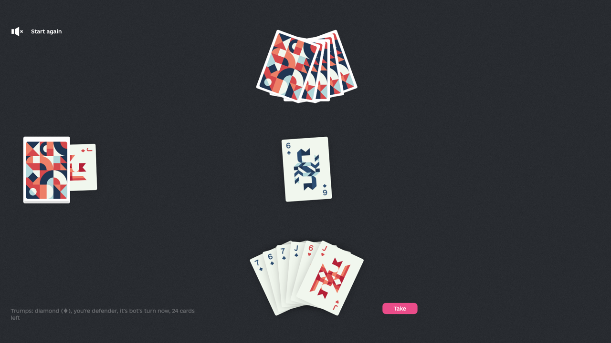

# Cards

The classic card game **Durak** against a bot, right in the browser.
Written in plain TypeScript, without frameworks or game engines.

**[Play at (https://crustbrns.github.io/cards-game/)](https://crustbrns.github.io/cards-game/)**



## The game

Durak ("fool") is the most popular card game in Ukraine and other post-Soviet countries.
The goal is to get rid of all your cards. Whoever is left holding cards at the end is the _durak_.

- 36-card deck (6 to Ace), 6 cards per hand. The bottom card of the deck sets the trump suit.
- The player with the lowest trump attacks first. If neither hand has a trump, the cards are reshuffled.
- The defender beats each card with a higher card of the same suit or with any trump, or takes everything on the table.
- The attacker can throw in more cards of any rank already on the table: up to 5 in the first bout, up to 6 after that.
- After each bout both hands are refilled to 6 cards from the deck.

## How to play

- **Attack:** drag a card from your hand up onto the table.
- **Defend:** drag your card onto an attacking card. The target is highlighted when you can drop it.
- **Take:** pick up all cards from the table instead of defending.
- **Done:** stop attacking; the beaten cards go to the discard pile.
- **Pass:** the bot has decided to take; stop throwing in and let it pick up the table.
- The speaker icon toggles sound. **Start again** deals a new game.

## Under the hood

- **No frameworks and no runtime dependencies.** Cards are plain DOM elements. Shuffling, dealing and every card move are CSS transforms and transitions.
- **Drag and drop** is built on mouse events, with custom hit-testing to find which attacking card you dropped on.
- **Rule-based bot.** It defends with the cheapest card that beats the attack and uses trumps only when it has to. It attacks with its lowest non-trump card, and when you take, it throws in matching ranks.
- **Sound effects** have several random variants per action, so repeated moves don't sound the same.
- **Scaling:** the scene is laid out at 1920×1080 and scales to the window width.

## Run locally

```bash
git clone https://github.com/Crustbrns/cards-game.git
cd cards-game
npm install
npx tsc
```

Then open `index.html` in a browser. No server is needed. Use `npx tsc --watch` while developing.

The compiled `.js` files are committed because GitHub Pages serves the repository as is. Rebuild before committing changes to `.ts` files.

## Project structure

```
index.html
resources/
├── scripts/
│   ├── game.ts                        # game flow: dealing, bot moves, card layout
│   ├── processing/logic.ts            # rules model: Card, Deck, Heap, Player, Bot
│   ├── events/events.ts               # drag and drop, hit-testing, resize
│   ├── userinterface/gui.ts           # buttons, info bar, end of turn, winner screen
│   ├── audioeffects/audiomanager.ts   # sound effects
│   └── restart/restart.ts             # restart and reshuffle
├── styles/                            # layout, card faces, animations
├── images/
├── sounds/
└── e-Ukraine/                         # font
```
